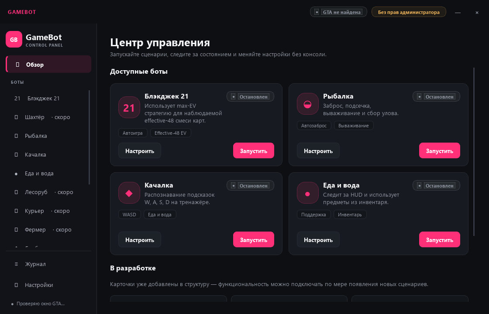

<p align="center">
  
</p>

<h1 align="center">GameBot Control</h1>

<p align="center">Одна панель для игровых сценариев GTA V / Majestic RP</p>

<p align="center">
  <a href="https://github.com/ansalim01/bot-gta-5-majestic/actions/workflows/quality.yml"></a>
  
  
  
</p>

<p align="center">
  <a href="#1-подготовьте-игру-и-файлы">Первый запуск</a> ·
  <a href="docs/configuration.md">Настройки</a> ·
  <a href="docs/troubleshooting.md">Решение проблем</a> ·
  <a href="docs/architecture.md">Архитектура</a>
</p>

Панель управления ботами для **GTA V / Majestic RP на Windows**.
Вы выбираете сценарий, меняете настройки и запускаете его кнопкой.
Бот распознаёт интерфейс игры по изображениям и отправляет нажатия клавиатуры и мыши.

**Для начала достаточно Python и инструкции ниже. Git и редактор кода не нужны.**
Сначала установите зависимости; готовый `.exe` этим репозиторием не предоставляется.



## Что доступно

| Сценарий | Возможности | Где запускается |
| --- | --- | --- |
| Блэкджек 21 | Подсказки или автоматические ходы, ставки, дабл, сплит и отчёты | В панели |
| Рыбалка | Подготовка, заброс, поклёвка, вываживание и сбор улова | В панели |
| Качалка | Подходы и распознавание подсказок W/A/S/D | В панели |
| Еда и вода | Проверка голода/жажды и использование предметов из инвентаря | В панели |
| Шахтёр | Отдельный сценарий добычи, мини-игры и маршрутов | [Из консоли](docs/configuration.md#шахтёр) |

Карточки с пометкой **«Скоро»** пока не запускаются. Панель запускает один сценарий за раз.

## 1. Подготовьте игру и файлы

Нужны:

- Windows 10/11 и Python 3.11+. Проверки проекта настроены на **Python 3.11 и 3.13**.
- Игра в режиме **«Оконный без рамки»**, разрешение **1920 × 1080**.
- Масштаб Windows **100%**, русский интерфейс игры, шрифт **ProximaNova**.
- Отключённые наложения поверх игрового интерфейса, например Discord overlay.

Для первого запуска разместите игру на первом мониторе. Часть сценариев по умолчанию
захватывает именно его; другой экран настраивается через `screen.monitor_index`.

Скачайте [ZIP с исходниками](https://github.com/ansalim01/bot-gta-5-majestic/archive/refs/heads/main.zip)
и распакуйте его. Дальше для примера
используется папка **`C:\game-bot`**. Если у вас другой путь, подставьте его в первой команде.
В выбранной папке должны лежать `launcher.py`, `requirements.txt`, папки `bot/` и `config/`.
При распаковке ZIP они могут оказаться во вложенной папке — открывать нужно именно её.

## 2. Установите зависимости один раз

Откройте **PowerShell** и выполните:

```powershell
cd "C:\game-bot"
python --version
python -m venv .venv
.\.venv\Scripts\python.exe -m pip install -r requirements.txt
```

Первая проверка должна показать Python 3.11 или новее. Дождитесь завершения установки
без сообщения `ERROR`. Папка `.venv` — отдельное окружение Python для этого проекта.
Активировать его и менять политику выполнения PowerShell для этих команд не требуется.

Если `python` не найден, но установлен Python Launcher, попробуйте `py -3.13 --version`
и создайте окружение командой `py -3.13 -m venv .venv`. Это вариант для установленного
Python 3.13. Остальные команды с `.venv\Scripts\python.exe` остаются теми же.
Другие ошибки разобраны в [решении проблем](docs/troubleshooting.md).

## 3. Откройте панель

Из той же папки выполните:

```powershell
.\.venv\Scripts\python.exe launcher.py
```

Подтвердите запрос Windows на запуск с правами администратора — UAC.
После этого должно открыться окно **GameBot Control** со списком сценариев.
Если отказаться от запроса, обычный запуск панели отменяется.

При следующих запусках достаточно перейти в папку проекта и выполнить эту команду.
Повторная установка зависимостей нужна после их изменения, например при обновлении проекта.

## 4. Запустите первый сценарий

1. Подготовьте персонажа в игре по таблице ниже. Закройте чат и посторонние меню.
2. В панели откройте нужный сценарий и проверьте его настройки.
3. Нажмите **«Запустить» один раз**. Панель сохранит видимые настройки и свернётся.
4. Вернитесь в окно игры. **Бот уже работает; нажимать F9 для старта после кнопки не нужно.**

| Сценарий | Что сделать в игре до запуска | Что ожидать |
| --- | --- | --- |
| Рыбалка | Подойти к месту ловли с подготовленным снаряжением, дождаться приглашения начать рыбалку через E | Бот нажмёт E и подтвердит уже выбранное снаряжение вторым E, затем начнёт цикл ловли |
| Качалка | Подойти вплотную к уличному тренажёру | Проверка еды/воды, начало упражнения через E, нажатия по распознанным буквам |
| Еда и вода | Находиться на основном игровом экране; иметь в инвентаре Cola и батончик, соответствующие шаблонам проекта | Проверка HUD; при голоде/жажде — открытие инвентаря и использование предмета |
| Блэкджек | Открыть игровой стол и заранее выбрать сумму ставки | Подсказки или автоматическая игра в зависимости от двух переключателей ниже |

Рыбалка и качалка используют встроенную проверку еды/воды. Для них тоже заранее
положите нужные предметы в инвентарь. Отдельный бот еды/воды параллельно им не нужен.

**Блэкджек:** в общей конфигурации автоматические ходы и ставки включены, лимиты
сессии отключены. Для наблюдения без автоматических нажатий выключите **оба**
переключателя: «Автоматически нажимать» и «Автоматически ставить».
«Размер ставки для отчёта» должен совпадать с выбранной на игровом столе суммой:
это поле само не выбирает сумму в игре.

## Пауза, остановка и выход

| Действие | Как выполнить |
| --- | --- |
| Поставить работающего бота на паузу / продолжить | **F9** или кнопка на странице сценария |
| Полностью остановить сценарий | **F10** или «Остановить» в панели |
| Запустить сценарий заново после остановки | Снова нажать «Запустить» в панели |
| Проверить еду/воду вне расписания | **F8** в работающем отдельном сценарии «Еда и вода» |
| Вернуть свёрнутую панель | Нажать её значок в системном трее, рядом с часами; значок может быть под стрелкой `^` |
| Завершить всё приложение | Правой кнопкой по значку в трее → **«Завершить приложение»** |

Клавиши указаны для общих настроек; свои назначения видны на странице сценария.
**Крестик окна сворачивает панель в трей и не останавливает работающего бота.**
Если нужно только прекратить действия в игре, используйте F10.

## Как менять настройки

Обычные параметры меняйте в панели. Кнопка «Запустить» автоматически сохраняет
видимые значения; «Сохранить настройки» позволяет сохранить их отдельно.
Чтобы применить изменения к работающему боту, **полностью остановите его и запустите
заново**. Пауза и продолжение не перечитывают конфигурацию.

Общие значения лежат в `config/*.yaml`, личные изменения — в `config/user/*.yaml`.
Личные файлы дополняют общие и не включаются в Git. Если параметра нет в панели,
его можно указать в личном файле: [пример и сброс настроек](docs/configuration.md#личные-настройки).

## Если что-то не работает

| Проблема | Первая проверка |
| --- | --- |
| Ошибка `No module named …` | Установите зависимости командой из шага 2 через `.venv\Scripts\python.exe` |
| Панель не появилась | Проверьте запрос UAC, консоль запуска и значок в трее |
| Бот стоит на месте | Проверьте состояние в панели, активное окно игры, нужное место и подсказку на экране |
| Еда/вода не используется | Без индикатора потребности инвентарь не открывается; проверьте наличие подходящих предметов |
| Не распознаётся интерфейс | Проверьте 1920 × 1080, масштаб 100%, русский язык, ProximaNova и выбранный монитор |
| Изменённые настройки не действуют | Остановите сценарий и запустите заново; после ручного изменения YAML полностью перезапустите панель |

Подробные действия: [решение проблем](docs/troubleshooting.md).
Сообщения процессов доступны на странице **«Журнал»**.
Отчёты о сессиях создаются локально при включённой телеметрии:

| Данные | Путь относительно папки проекта |
| --- | --- |
| Последний отчёт рыбалки | `logs/fishing_sessions/latest_summary.txt` |
| Последний отчёт блэкджека | `logs/blackjack_sessions/latest_summary.txt` |
| Подробные события | JSONL в тех же папках |

## Остальные инструкции

- [Режимы сценариев, настройки вручную, запуск без консоли и калибровка](docs/configuration.md)
- [Запись маршрутов шахтёра](config/routes/README.md)
- [Разработка и запуск тестов](docs/development.md)
- [Архитектура](docs/architecture.md) · [Вклад в проект](CONTRIBUTING.md)
- [Сообщить об ошибке](https://github.com/ansalim01/bot-gta-5-majestic/issues/new/choose)

## Как помочь проекту

Исправления и улучшения приветствуются: можно улучшать распознавание,
добавлять тесты, исправлять интерфейс и дополнять инструкции.
Сделайте **fork**, создайте отдельную ветку и откройте **pull request в `main`**.
Пошаговый порядок — в [CONTRIBUTING.md](CONTRIBUTING.md).

Для pull request автоматически запускаются линтер, проверка форматирования
и тесты на **Python 3.11 и 3.13**. Изменения участников принимаются после
успешных проверок и одобрения владельца проекта **@ansalim01**.
Для первого PR нового участника GitHub может запросить разрешение на запуск тестов.

Нашли ошибку или хотите предложить функцию? Создайте
[issue](https://github.com/ansalim01/bot-gta-5-majestic/issues/new/choose),
даже если пока не готовы писать код.

## Связь и поддержка

Автор проекта в Telegram: **[@ansalim](https://t.me/ansalim)**.
Можно написать по вопросам сотрудничества и поддержки проекта.
Ошибки и предложения по коду удобнее оставлять в issues: так их увидят
остальные участники, и обсуждение сохранится рядом с проектом.

## Ограничения

Распознавание зависит от интерфейса игры: после изменения HUD, шрифта, масштаба
или расположения элементов может потребоваться калибровка. Автотесты не заменяют
проверку захвата и таймингов в живой игре.

Блэкджек использует модель effective-48 max-EV v11 на основе наблюдений проекта
и не гарантирует прибыль. Использование автоматизации может нарушать правила
сервера и привести к блокировке аккаунта.
