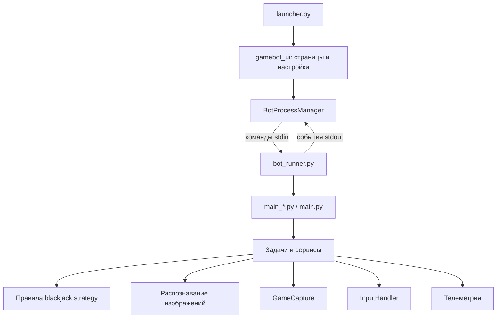

# Архитектура

GameBot состоит из настольной панели и отдельных рабочих процессов.
Панель не выполняет распознавание кадров и не отправляет игровые нажатия.
Один рабочий процесс владеет захватом экрана, вводом и выполняемым сценарием.

## Ответственность модулей

| Модуль | Ответственность |
| --- | --- |
| `launcher.py`, `GameBot.pyw` | Запуск панели, проверка зависимостей, запрос прав |
| `gamebot_ui/app.py` | Главное окно, навигация, трей и соединение сигналов |
| `gamebot_ui/pages.py` | Композиция страниц и пользовательские действия |
| `gamebot_ui/settings.py` | Редакторы значений по метаданным `SettingField` |
| `gamebot_ui/models.py` | Каталог сценариев, полей настроек и показателей |
| `gamebot_ui/validation.py`, `gamebot_ui/diagnostics.py` | Проверка значений полей и безопасное отображение отчётов |
| `gamebot_ui/process_manager.py` | Жизненный цикл процесса, команды, поток событий |
| `bot_runner.py` | Адаптер точек входа к протоколу управления |
| `main*.py` | Сборка зависимостей, горячие клавиши, главный цикл, очистка ресурсов |
| `bot/jobs/` | Координация действий игрового сценария |
| `bot/blackjack/strategy.py` | Чистые правила карт, стратегии, дабла и диагностического счёта |
| `bot/detectors/` | Анализ кадров и распознавание игровых элементов |
| `bot/services/sustenance.py` | Повторно используемый сервис еды и воды |
| `bot/capture.py`, `bot/input_handler.py` | Экран, координаты, фокус и системный ввод |
| `bot/navigation/` | Маршруты и навигация по миникарте |
| `bot/telemetry/` | События JSONL и отчёты о сессиях |
| `bot/config_loader.py`, `bot/config_values.py` | Чтение, слияние, запись и адресация настроек |
| `bot/windows.py`, `bot/hotkeys.py` | Общие операции платформы и разбора клавиш |
| `bot/runtime.py` | Очистка задачи, захвата и слушателя клавиш, даже если один из шагов завершился ошибкой |

Зависимости передаются задачам через конструктор: задача получает захват,
обработчик ввода и, при необходимости, машину состояний или сервис.
Тест может подставить эти объекты без настоящего окна игры.
Доменный модуль стратегии не импортирует OpenCV, NumPy, Qt, захват или ввод.
Прежние импорты функций из `bot.jobs.blackjack` сохранены как совместимые экспорты.

## Цикл блэкджека

`BlackjackJob.tick()` координирует последовательность:

1. `_read_table()` получает один общий кадр и распознаёт суммы и панели.
2. Без панели хода `_observe_inactive_turn()` отслеживает раздачу и результат.
3. `_prepare_player_turn()` подтверждает OCR и завершение предыдущего действия.
4. `_recommend_action()` применяет стратегию, политику дабла и лимиты.
5. `_report_decision()` сообщает о новом решении.
6. `_execute_decision()` проверяет разрешение ввода, повторы и задержки, отправляет действие и записывает его.

Наблюдения и рекомендации передаются именованными dataclass-объектами.
Подтверждение и ограниченные повторы старого действия учитываются отдельно
от новых решений.

## Межпроцессное управление

Команды — строки `pause`, `resume`, `start`, `stop`, `check_now` в stdin.
События — JSON после префикса `@@GAMEBOT_EVENT@@` в stdout, по одному на строку.
Формат задаётся в `bot/control_protocol.py` и используется обеими сторонами.
Обычные строки stdout остаются журналом для пользователя.

Менеджер собирает строки из произвольных порций байтов, сохраняет состояние
UTF-8-декодера и дочитывает последнее событие при завершении процесса.
Некорректный JSON остаётся в журнале. Ошибка запуска освобождает ссылку на процесс.
Таймеры принудительной остановки привязаны к конкретному процессу, чтобы
задержавшийся таймер не остановил следующую сессию.

Сигналы Qt также проверяют принадлежность текущему процессу. Отложенное
переключение сценария можно отменить остановкой, новым запросом запуска или
завершением панели. Запоздавшие события готовности и состояния не отменяют
запрошенную остановку. Начальное состояние рабочего процесса устанавливается
до запуска читателя команд; потеря stdin останавливает задачу и отпускает клавиши.

## Конфигурация

`config/<name>.yaml` содержит документированные общие значения.
`config/user/<name>.yaml` рекурсивно переопределяет выбранные поля.
Корень YAML должен быть словарём; ошибочный файл не перезаписывается панелью.
Запись идёт во временный файл рядом с целевым, затем выполняется замена.
При ошибке сериализации или замены исходный файл сохраняется.

Панель проверяет типы и границы полей из `BotSpec`, допустимые варианты
выбора и назначение управляющих клавиш. Неполная загрузка блокирует
сохранение и запуск страницы. Эта проверка охватывает настройки панели;
полная схема всех внутренних параметров игровых YAML пока не задана.

Доступ по путям вида `blackjack.risk.max_session_loss` находится в общем
модуле конфигурации. Панель описывает поля и собирает значения, а сохранение
делегирует `ConfigStore` и общему механизму записи.

## Подключение сценария

1. Создайте задачу в `bot/jobs/` с переданными захватом и вводом, `tick()` и очисткой ресурсов.
2. Добавьте конфигурацию, детекторы и тесты на репрезентативных кадрах.
3. Создайте точку входа с циклом, горячими клавишами и завершением.
4. Подключите фабрику и допустимый идентификатор в `bot_runner.py`.
5. Опишите `BotSpec` в `gamebot_ui/models.py`; включайте `available=True` после проверки.
6. Проверьте запуск, паузу, остановку, повторный запуск и запись настроек.

## Границы текущей архитектуры

В части детекторов ещё есть блокирующие методы `solve()`, совмещающие
распознавание и ввод. Общий `BotState` объединяет состояния разных профессий.
Рабочий адаптер пока читает внутренние поля старых точек входа, а его
командный поток меняет машину состояний параллельно главному циклу.

Дальнейшее разделение этих мест требует отдельных тестов прерывания и проверки
в игре. Тайминги рабочего заброса рыбалки сохранены; массовый перенос его
состояний в новую абстракцию не входит в этот рефакторинг.
